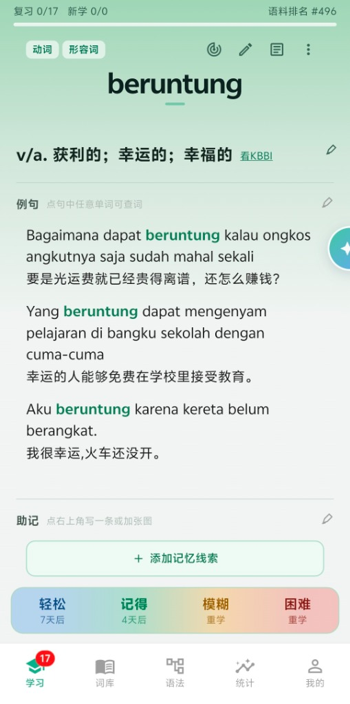

**中文** | [English](README_EN.md)

# KataMemo — 印尼语背单词学习软件

面向中文学习者的开源印尼语背单词 Android 应用（Flutter + SQLite + FSRS-6）。

> 直接下载安装包请前往 [**Releases**](https://github.com/laocen69-boop/KataMemo/releases) 页面获取最新 `KataMemo-*.apk`（仅支持 `arm64-v8a`）。

---

## 界面预览

| 学习页 | 主题词库 | 语法专题 | 问一问 AI 助手 |
| :---: | :---: | :---: | :---: |
|  |  |  |  |

---

## 主要特性

- **大规模离线词库**：内置 **96,519** 条印尼语词条、**184** 个分类词书节点、**84,784** 条自产双语例句，以及 50 个高频功能词的自编用法说明。
- **FSRS-6 记忆算法**：支持自定义学习目标与每日限额、遗忘率与学习趋势统计，并内置端内本地参数优化（基于 `fsrs-rs` 编译的 `libfsrs.so`）。
- **离线内置发音**：随包附带 **96,518** 条分片打包语音（`app/assets/audio_pack/`），点词、抓词与例句均支持离线播放。
- **语法与写作**：内置独立编写的印尼语语法与写作专题，支持横向目录自动定位、学习进度记录与块级自定义笔记编辑。
- **扩展学习工具**：支持自建词卡（本地自动多标签归类）、拍照抓词（Google ML Kit）、以及本地通用词典导入。
- **可选「问一问」AI 助手**：在填入自己的 API Key 前**完全离线运行**；填 Key 后由设备直连你选择的模型服务商，不经过任何中转服务器。

---

## 目录结构

```text
├── app/                     # Flutter 应用源码、资源与测试
│   ├── lib/                 # Dart 源码
│   ├── assets/data/         # 词库、词书、语法与写作 JSON
│   ├── assets/audio_pack/   # 离线分片语音包
│   └── test/                # 单元测试与 Widget 测试
├── docs/                    # iOS 打包说明等文档（实验性，尚未在 macOS / 真机验证）
├── scripts/                 # iOS 资源准备与导出辅助脚本
├── OPEN_SOURCE_NOTES.md     # 开源数据范围、隐私与第三方来源说明
├── THIRD_PARTY_NOTICES.md   # 第三方开源组件声明
└── LICENSE                  # MIT 许可证
```

> **平台说明**：当前仅在 **Android（`arm64-v8a`）** 完成完整测试与真机验证；`app/ios/` 与 `docs/iOS打包说明.md` 为实验性 iOS 适配草稿，尚未在 macOS / iPhone 真机编译验证，欢迎有 Mac 环境的开发者协助完善。

---

## 从源码构建

需要 **Flutter 3.44+**（Dart 3.12+）与 Android SDK（JDK 17）：

```bash
git clone https://github.com/laocen69-boop/KataMemo.git
cd KataMemo/app
flutter pub get
flutter build apk --release --target-platform android-arm64
```

构建产物位于 `app/build/app/outputs/flutter-apk/app-release.apk`。

> 注：本仓库包含 `.github/workflows/release.yml`，支持在 GitHub Actions 页面手动触发云端编译并自动发布 Release APK。

---

## 开源说明、致谢与许可证

- **致谢开源项目**：
  - [open-spaced-repetition](https://github.com/open-spaced-repetition)（`fsrs-rs` / `fsrs-rs-c` / `ts-fsrs`）：本项目 FSRS-6 记忆算法与端内参数优化的核心参考与原生实现基础
  - [wordfreq](https://github.com/rspeer/wordfreq)（Robyn Speer 等，CC BY-SA 4.0）：词频分层标签划分参考
  - [Flutter](https://flutter.dev)、[Google ML Kit](https://developers.google.com/ml-kit) 及各 Flutter 社区依赖库
- 词库新增、校对与音频打包工作流见 [docs/词库贡献与新增工作流.md](docs/词库贡献与新增工作流.md)（配套校验与打包脚本见 `tools/`）
- 数据来源边界、隐私说明及 KBBI / TTS 资源披露见 [OPEN_SOURCE_NOTES.md](OPEN_SOURCE_NOTES.md)
- 完整第三方依赖许可见 [THIRD_PARTY_NOTICES.md](THIRD_PARTY_NOTICES.md)
- 本项目源码采用 [MIT License](LICENSE) 开源
